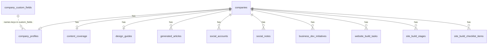

# Supabase schema audit (public)

**Date:** 2026-08-05  
**Project:** The Night Ventures (`tnwopydrxibqfmeoehid.supabase.co`)  
**Sources:** `supabase/migrations/001`–`017`, app usage in `src/` / `docs/SYSTEM.md`  
**Live data:** Row counts and real sample rows could **not** be fetched from this environment. Local `.env.local` has a valid anon key, but all business tables use RLS `TO authenticated`. The service-role key is a placeholder locally; Vercel “Sensitive” env vars pull as empty. See [Appendix A](#appendix-a--sql-to-fill-live-counts--samples) to complete sections 1–2 after running SQL in the Supabase dashboard (or after adding `SUPABASE_SERVICE_ROLE_KEY` to `.env.local`).

---

## 1. Tables in `public` (from migrations)

| Table | Purpose (short) | Approx. rows (live) |
| --- | --- | --- |
| `profiles` | App user profile (extends `auth.users`) | *pending — run Appendix A* |
| `companies` | Workspace / client company records | *pending* |
| `inquiries` | Public contact form submissions | *pending* |
| `company_custom_fields` | Global custom-field name definitions | *pending* |
| `company_profiles` | 1:1 company positioning + SEO architecture | *pending* |
| `social_accounts` | Social / shop accounts per company | *pending* |
| `social_notes` | Freeform social-tracker notes per company | *pending* |
| `business_dev_initiatives` | Biz-dev tracker rows per company | *pending* |
| `website_build_tasks` | Website-build tracker rows per company | *pending* |
| `general_documents` | Global prompt/checklist docs (not company-scoped) | *pending* |
| `design_guides` | Structured design-guide builder fields (1:1 company) | *pending* |
| `design_guide_themes` | Reusable design-guide themes (global) | *pending* |
| `content_coverage` | SEO coverage tree (pillars → supporting → articles) | *pending* |
| `generated_articles` | Saved Article Generator drafts | *pending* |
| `site_build_stages` | Site Build Flow stage status per company | *pending* |
| `site_build_checklist_items` | Site Build Flow checklist rows per company | *pending* |

**No tables named** `projects`, `sites`, `clients`, `businesses`, `chats`, `conversations`, or `insights` exist in migrations.

---

## 2. Company / business / “project” related tables

### 2.1 `companies`

**Role:** Parent workspace entity. Almost every tool keys off `company_id`. In product language this is the client/company; there is no separate project entity.

| Column | Type | Notes |
| --- | --- | --- |
| `id` | `uuid` PK | `gen_random_uuid()` |
| `name` | `text` NOT NULL | Display name |
| `created_at` | `timestamptz` NOT NULL | default `now()` |

**PK:** `id`  
**FKs:** none (referenced by many children)  
**RLS:** authenticated can manage all rows  

**Sample rows:** *pending — Appendix A*

---

### 2.2 `company_profiles`

**Role:** Canonical company data store for positioning, domain, keywords, competitors, services, team, design-guide abstract. **One row per company** (`company_id` UNIQUE).

| Column | Type | Notes |
| --- | --- | --- |
| `id` | `uuid` PK | |
| `company_id` | `uuid` NOT NULL UNIQUE | → `companies(id)` ON DELETE CASCADE |
| `domain` | `text` | Domain/URL string (UI placeholder `example.com`) |
| `product_name` | `text` | |
| `abstract` | `text` | Business abstract (shortest positioning blurb) |
| `short_description` | `text` | Short description |
| `medium_description` | `text` | Medium description |
| `long_description` | `text` | Long description |
| `custom_fields` | `jsonb` NOT NULL | default `{}`; keys = names from `company_custom_fields` |
| `updated_at` | `timestamptz` NOT NULL | |
| `core_keywords` | `jsonb` NOT NULL | default `[]` — pillar keyword architecture |
| `competitors` | `jsonb` NOT NULL | default `[]` — `{ name, url }[]` |
| `design_guide_raw` | `text` | Full pasted Design Guide.md |
| `design_guide_abstract` | `text` | AI-distilled brand/design summary (not business abstract) |
| `services` | `jsonb` NOT NULL | default `[]` — `{ title, summary, detail? }[]` |
| `team_members` | `jsonb` NOT NULL | default `[]` — `{ name, role, bio, credentials?, same_as? }[]` |

**PK:** `id`  
**FKs:** `company_id` → `companies.id`  
**Cardinality:** **1:1** with `companies`

**JSON shapes (enforced in UI, not SQL):**

```json
// core_keywords
[
  { "keyword": "pillar phrase", "supporting": ["kw1", "kw2", "kw3", "kw4", "kw5"] }
]

// competitors
[{ "name": "Competitor Co", "url": "https://competitor.com" }]

// services
[{ "title": "Service", "summary": "...", "detail": "optional longer copy" }]

// team_members
[{
  "name": "Jane",
  "role": "Founder",
  "bio": "...",
  "credentials": "optional",
  "same_as": ["https://linkedin.com/in/..."]
}]
```

**Sample rows:** *pending — Appendix A* (redact emails/keys if any appear in `custom_fields` / free text)

---

### 2.3 `company_custom_fields`

**Role:** Global registry of custom field *names*. Values live in `company_profiles.custom_fields` keyed by those names. No fixed industry/ICP columns — entirely user-defined.

| Column | Type | Notes |
| --- | --- | --- |
| `id` | `uuid` PK | |
| `name` | `text` NOT NULL UNIQUE | Field key / label |
| `created_at` | `timestamptz` NOT NULL | |

**PK:** `id`  
**FKs:** none (logical key into JSON)  

**Sample rows:** *pending — Appendix A*

---

### 2.4 `content_coverage`

**Role:** Per-company SEO content-coverage dashboard. Mirrors Company Data pillars; holds planned/drafted/published article plans.

| Column | Type | Notes |
| --- | --- | --- |
| `id` | `uuid` PK | |
| `company_id` | `uuid` NOT NULL UNIQUE | → `companies(id)` ON DELETE CASCADE |
| `pillars` | `jsonb` NOT NULL | default `[]` |
| `updated_at` | `timestamptz` NOT NULL | |

**PK:** `id`  
**FKs:** `company_id` → `companies.id`  
**Cardinality:** **1:1** with `companies`

**`pillars` shape (UI):**

```json
[{
  "slug": "investor-outreach",
  "keyword": "investor outreach",
  "pillarArticle": { /* article plan object or status */ },
  "supporting": [{
    "slug": "investor-crm",
    "keyword": "investor crm",
    "clusterRationale": "...",
    "plannedArticles": [{
      "type": "howto",
      "title": "...",
      "targetKeyword": "...",
      "status": "planned|drafted|published",
      "keyMessages": [],
      "publishedUrl": "optional",
      "publishedAt": "optional"
    }]
  }]
}]
```

**Sample rows:** *pending — Appendix A* (truncate large `pillars` JSON in samples)

---

### 2.5 `generated_articles`

**Role:** Full saved article drafts from Article Generator (library). Many rows per company.

| Column | Type | Notes |
| --- | --- | --- |
| `id` | `uuid` PK | |
| `company_id` | `uuid` NOT NULL | → `companies(id)` ON DELETE CASCADE |
| `pillar_keyword` | `text` NOT NULL | |
| `supporting_keyword` | `text` | null for pillar hub articles |
| `type` | `text` NOT NULL | `comprehensive` \| `howto` \| `comparison` \| `faq` \| `flex` |
| `target_keyword` | `text` NOT NULL | |
| `status` | `text` NOT NULL | `drafted` \| `published` (library status; CMS publish is external) |
| `title` | `text` NOT NULL | |
| `description` | `text` NOT NULL | meta description |
| `slug` | `text` NOT NULL | unique with `company_id` |
| `date` | `text` | |
| `updated_date` | `text` | |
| `author` | `text` | |
| `category` | `text` | article category (CMS frontmatter) |
| `tags` | `jsonb` NOT NULL | default `[]` — article tags |
| `image_alt` | `text` | |
| `keywords` | `jsonb` NOT NULL | default `[]` — related keywords list |
| `draft` | `boolean` NOT NULL | default `true` |
| `internal_links` | `jsonb` NOT NULL | |
| `external_links` | `jsonb` NOT NULL | |
| `faqs` | `jsonb` NOT NULL | |
| `body` | `text` NOT NULL | markdown body |
| `created_at` / `updated_at` | `timestamptz` | |
| `where_things_stand_sources` | `jsonb` NOT NULL | `{ url, note }[]` research sources |

**PK:** `id`  
**FKs:** `company_id` → `companies.id`  
**Unique:** `(company_id, slug)`  
**Cardinality:** **1:N** companies → articles  

**Sample rows:** *pending — Appendix A* (omit or truncate `body`)

---

### 2.6 `social_accounts` / `social_notes`

| Table | Columns (summary) | FK |
| --- | --- | --- |
| `social_accounts` | `id`, `company_id`, `name`, `type` (`Social Media`\|`Digital Store`\|`Other`), `url`, `username`, `access_details`, `status`, `comments`, `created_at` | → `companies` |
| `social_notes` | `id`, `company_id`, `text`, `created_at` | → `companies` |

**Cardinality:** **1:N** each. Closest existing “notes” store — social-tracker only, not SEO insights.

**Sample rows:** *pending — Appendix A* (redact `access_details`, usernames if sensitive)

---

### 2.7 `business_dev_initiatives` / `website_build_tasks`

Simple tracker tables: `id`, `company_id`, `item`, `comments`, `owner`, `status`, `created_at`. Both **1:N** → `companies`. Operational, not SEO content.

---

### 2.8 `design_guides` / `design_guide_themes`

| Table | Key columns | Cardinality |
| --- | --- | --- |
| `design_guides` | `company_id` UNIQUE, `fields` jsonb | **1:1** company (structured builder UI) |
| `design_guide_themes` | `name` UNIQUE, `fields` jsonb | Global, not company-scoped |

Note: Company Data also stores `design_guide_raw` + `design_guide_abstract` on `company_profiles` — a parallel path to the structured `design_guides` table.

---

### 2.9 `site_build_stages` / `site_build_checklist_items`

Site Build Flow tracker. Stages PK is `(company_id, stage_key)`. Checklist items are **1:N** per company. This is the closest thing to a “site project” lifecycle — still keyed by **company**, not a separate site entity. Checklist `note` / `proof_url` can hold deploy URLs and QA notes.

Active v2 `stage_key` values include: `infra-build`, `design-build`, `deployment-infra`, `make-it-specific`, `seed-content`, `full-site-content-build`, `live-wiring-qa` (plus legacy v1 keys retained).

---

### 2.10 Related but not company-scoped

| Table | Relevance |
| --- | --- |
| `general_documents` | Global Build Prompt / QA Checklist / Design System Prompt text (`key`, `title`, `content`) |
| `profiles` | Auth users (`id` → `auth.users`) |
| `inquiries` | Marketing contact form (`name`, `email`, `message`, `status`) — **not** company CRM |

---

## 3. Where specific SEO / company facts live

| Need | Exists? | Exact location | Shape / notes |
| --- | --- | --- | --- |
| Business abstract / description (short / medium / long) | **Yes** | `company_profiles.abstract`, `.short_description`, `.medium_description`, `.long_description` | Four separate `text` columns. `abstract` is the short positioning blurb used by Plan Cluster / Article Generator. |
| Design / brand abstract (related, different) | **Yes** | `company_profiles.design_guide_abstract` (+ raw in `.design_guide_raw`) | Brand/visual context for other tools — **not** a business ICP abstract. |
| Services offered | **Yes** | `company_profiles.services` | JSONB array `{ title, summary, detail? }`. |
| Competitors | **Yes** | `company_profiles.competitors` | JSONB array `{ name, url }` on the profile — **not** a separate table. Used exclusively as competitor set for Plan Cluster. |
| Target audience / ICP | **No first-class field** | — | Not in schema. Topic Generator API (`api/topic-generator.js`, largely unwired) accepts `audienceText` / `audienceSelected` in request body only — **not persisted**. Could be parked in `custom_fields` if someone created a custom field name, but there is no dedicated column. |
| Keyword / SEO data | **Yes (multiple layers)** | See below | |
| → Pillar architecture | | `company_profiles.core_keywords` | Pillars + supporting keyword strings. UI default ~5×5; Rupert uses 7×5. |
| → Coverage / plans | | `content_coverage.pillars` | Full planning tree + statuses + published URLs. |
| → Draft articles | | `generated_articles.*` | `pillar_keyword`, `supporting_keyword`, `target_keyword`, `keywords`, `tags`, `category`, body, etc. |
| → External research (ephemeral) | | Not stored | Semrush paste / DataForSEO calls are request-time; not a DB table. |
| Domain / URL per company | **Yes** | `company_profiles.domain` | Free-text domain. Also social URLs in `social_accounts.url`; checklist `proof_url` for deploy proofs. |
| Chat / conversation / insights tables | **No** | — | No chat/conversation/message tables. Closest notes: `social_notes.text`, tracker `comments`, checklist `note`. |
| Tags / categories / industry | **Partial** | | |
| → Article tags/category | | `generated_articles.tags` (jsonb), `.category` (text) | Per article, CMS frontmatter — not company industry. |
| → Company industry / taxonomy | **No** | — | No industry enum/table. Extensible only via `company_custom_fields` + `custom_fields` JSON. |
| Team / founders (E-E-A-T adjacent) | **Yes** | `company_profiles.team_members` | JSONB; used by Specific Prompt / site content tools. |

---

## 4. Companies vs projects / sites — relationships

```
companies (1)
 ├── company_profiles (0..1)          -- positioning + SEO architecture
 ├── content_coverage (0..1)          -- coverage tree
 ├── design_guides (0..1)             -- structured design guide builder
 ├── generated_articles (0..N)
 ├── social_accounts (0..N)
 ├── social_notes (0..N)
 ├── business_dev_initiatives (0..N)
 ├── website_build_tasks (0..N)
 ├── site_build_stages (0..N rows; composite PK company_id+stage_key)
 └── site_build_checklist_items (0..N)
```

**How “project” is defined today**

- There is **no** `projects` or `sites` table.
- A **company** is the unit of work: routes are `/company/:companyId/...`.
- “Site” means the external Astro/CMS site being built for that company; progress is tracked in Site Build Flow tables still keyed by `company_id`.
- Relationship company ↔ site/project is effectively **1:1 by convention** (one company row → one site build), not modeled as 1:N sites.

**Implication for SEO chat:** scope conversations to `companies.id` (and join `company_profiles` / `content_coverage`). Do not invent a parallel `projects` entity unless you truly need multiple sites per company.

---

## 5. Overlap / conflict flags for a new SEO insights / chat feature

Reuse these — **do not duplicate**:

| Existing asset | Why it matters for SEO chat |
| --- | --- |
| `company_profiles.abstract` + short/medium/long | Primary business positioning already collected in Company Data |
| `company_profiles.domain` | Site identity |
| `company_profiles.services` | Offering inventory |
| `company_profiles.competitors` | Competitor set already structured |
| `company_profiles.core_keywords` | Pillar SEO architecture source of truth |
| `content_coverage.pillars` | Planned/drafted/published content map — gold for “what have we covered?” |
| `generated_articles` | Actual draft copy + target keywords |
| `company_profiles.design_guide_abstract` | Brand voice/visual constraints for generated advice |
| `company_profiles.team_members` | Authority / about context |

**Gaps the new feature may need (safe to add — nothing conflicts today):**

| Gap | Suggestion |
| --- | --- |
| Chat / message history | New tables (e.g. `seo_chats`, `seo_chat_messages`) keyed by `company_id` — no overlap |
| Persisted insights / recommendations | New table or jsonb column — do **not** overload `social_notes` or tracker `comments` |
| Target audience / ICP | **Missing** — new column(s) on `company_profiles` (or structured jsonb) preferred over burying in `custom_fields` |
| Industry / vertical classification | **Missing** — same recommendation |
| Rank / GSC / Semrush snapshots | **Missing** as stored data — only checklist reminders exist in Site Build Flow |
| “Project” separate from company | Avoid unless multi-site-per-company is a real requirement |

**Naming collisions to avoid:**

- Do not add another `abstract` meaning brand/design — `design_guide_abstract` already owns that.
- Do not add a second `competitors` list; extend the existing JSON shape if you need more competitor fields (e.g. notes, strengths).
- Do not fork keyword storage; keep `core_keywords` as architecture and `content_coverage` as planning status.
- Article `tags` / `category` are CMS article metadata, not company taxonomy — keep separate from any company-level industry tags.

**Unwired but relevant code:** `api/topic-generator.js` already thinks in terms of `audienceText`, `domain`, `description`, `coreKeywords`, competitors, DataForSEO shortlists. That request shape is a useful checklist for what an SEO chat context pack should load from DB — but audience fields are not persisted yet.

---

## Entity relationship (compact)



---

## Appendix A — SQL to fill live counts + samples

Run in Supabase SQL Editor (service role / dashboard), then paste results back into sections 1–2.

```sql
-- 1) Row counts for all public base tables
select c.relname as table_name, c.reltuples::bigint as est_rows
from pg_class c
join pg_namespace n on n.oid = c.relnamespace
where n.nspname = 'public' and c.relkind = 'r'
order by 1;

-- Exact counts:
select 'companies' as t, count(*) from public.companies
union all select 'company_profiles', count(*) from public.company_profiles
union all select 'company_custom_fields', count(*) from public.company_custom_fields
union all select 'content_coverage', count(*) from public.content_coverage
union all select 'generated_articles', count(*) from public.generated_articles
union all select 'social_accounts', count(*) from public.social_accounts
union all select 'social_notes', count(*) from public.social_notes
union all select 'business_dev_initiatives', count(*) from public.business_dev_initiatives
union all select 'website_build_tasks', count(*) from public.website_build_tasks
union all select 'design_guides', count(*) from public.design_guides
union all select 'design_guide_themes', count(*) from public.design_guide_themes
union all select 'site_build_stages', count(*) from public.site_build_stages
union all select 'site_build_checklist_items', count(*) from public.site_build_checklist_items
union all select 'general_documents', count(*) from public.general_documents
union all select 'profiles', count(*) from public.profiles
union all select 'inquiries', count(*) from public.inquiries;

-- 2) Sample companies + profiles (redact in export if needed)
select id, name, created_at from public.companies order by created_at limit 3;

select
  company_id,
  domain,
  product_name,
  left(abstract, 120) as abstract_preview,
  left(short_description, 120) as short_preview,
  left(medium_description, 120) as medium_preview,
  left(long_description, 120) as long_preview,
  core_keywords,
  competitors,
  services,
  custom_fields,
  updated_at
from public.company_profiles
limit 3;

select name from public.company_custom_fields order by created_at;

select company_id, jsonb_array_length(pillars) as pillar_count, updated_at
from public.content_coverage
limit 3;

select
  company_id, pillar_keyword, supporting_keyword, type, target_keyword,
  status, title, slug, category, tags, keywords, draft, created_at
from public.generated_articles
order by created_at desc
limit 3;
```

Alternatively: put a real `SUPABASE_SERVICE_ROLE_KEY` in `.env.local` and re-ask for this audit’s live sections to be filled automatically.

---

## Appendix B — Migration index

| Migration | What it added |
| --- | --- |
| `001_combined_init.sql` | `profiles`, `companies`, `inquiries` |
| `003_company_data.sql` | `company_custom_fields`, `company_profiles` (+ descriptions, domain, custom_fields) |
| `004_social_tracker.sql` | `social_accounts`, `social_notes` |
| `005_simple_trackers.sql` | `business_dev_initiatives`, `website_build_tasks` |
| `006` / `007` | `general_documents` (+ design system doc seed) |
| `008_design_guide.sql` | `design_guides`, `design_guide_themes` |
| `009_core_keywords.sql` | `company_profiles.core_keywords` |
| `010_content_coverage.sql` | `content_coverage` |
| `011_competitors.sql` | `company_profiles.competitors` |
| `012` / `013` | `generated_articles` (+ `where_things_stand_sources`) |
| `014_company_design_guide.sql` | `design_guide_raw`, `design_guide_abstract` |
| `015` / `016` | Site Build Flow stages + checklist (v1 then v2 keys) |
| `017_company_services_team.sql` | `services`, `team_members` |
